# Multithreaded Programming Using Pthreads and OpenMP

## 1. Objective

To study and implement multithreaded programming using POSIX Threads (Pthreads) and OpenMP, including:

- Thread creation
- Multiple-thread execution
- Work distribution
- Race conditions
- Synchronization
- Mutexes
- Critical sections
- Barriers
- Reduction
- Performance analysis

---

## 2. Problem Statement / Scope

The experiment focuses on understanding how multiple threads can execute a computational workload concurrently using two different multithreading approaches:

- **POSIX Threads (Pthreads)** — explicit thread creation, workload distribution, synchronization, and result aggregation.
- **OpenMP** — directive-based parallel programming with built-in support for parallel regions, reduction, critical sections, and barriers.

The experiment also compares sequential execution with Pthreads and OpenMP implementations to study execution time, speedup, and efficiency.

---

## 3. Concepts / Computing Approaches

### Pthreads

Pthreads provides explicit control over thread creation and synchronization.

The experiment covers:

- Thread creation using `pthread_create()`
- Waiting for threads using `pthread_join()`
- Multiple thread execution
- Work distribution
- Race conditions
- Mutex synchronization

### OpenMP

OpenMP provides a directive-based approach for shared-memory parallel programming.

The experiment covers:

- Parallel regions
- Parallel loop execution
- Reduction
- Race conditions
- Critical sections
- Barriers

---

## 4. Experiment Workflow

The experiment was carried out in the following stages:

```text
Thread Creation
      ↓
Multiple Threads
      ↓
Work Distribution
      ↓
Race Condition
      ↓
Synchronization
      ↓
OpenMP Parallel Programming
      ↓
Performance Measurement
      ↓
Execution Time
      ↓
Speedup
      ↓
Efficiency
```

The performance experiment uses the same computational workload for:

```text
Sequential
   ↓
Pthreads
   ↓
OpenMP
```

with different thread counts.

---

## 5. Project Structure

```text
Multithreaded-Programming/
├── pthread/
│   ├── thread1.c
│   ├── thread2.c
│   ├── thread_sum.c
│   ├── race.c
│   └── mutex.c
│
├── openmp/
│   ├── omp1.c
│   ├── omp_sum.c
│   ├── omp_race.c
│   ├── omp_critical.c
│   └── omp_barrier.c
│
├── performance/
│   ├── sequential.c
│   ├── pthread_perf.c
│   ├── omp_perf.c
│   ├── execution_time_comparison.png
│   ├── speedup_comparison.png
│   └── efficiency_comparison.png
│
├── screenshots/
│
└── README.md
```

---

# 6. Implementation

## 6.1 Pthreads Experiments

### 6.1.1 Thread Creation

**Source:** `pthread/thread1.c`

Demonstrates thread creation using `pthread_create()` and waiting for thread completion using `pthread_join()`.

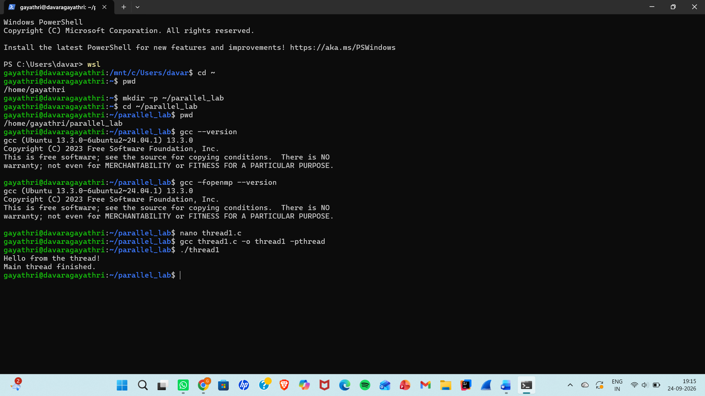

---

### 6.1.2 Multiple Pthreads

**Source:** `pthread/thread2.c`

Demonstrates the execution of multiple Pthreads.

The output order may vary because thread scheduling is nondeterministic.


---

### 6.1.3 Work Distribution

**Source:** `pthread/thread_sum.c`

The workload is divided among multiple threads and the partial results are combined.

Observed total:

```text
360
```

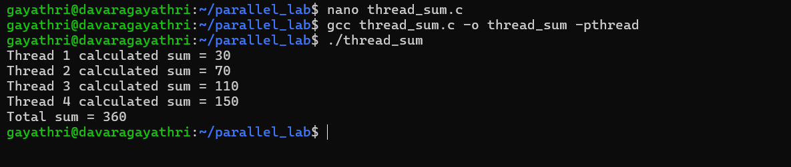

---

### 6.1.4 Race Condition

**Source:** `pthread/race.c`

Multiple threads update a shared variable without synchronization, demonstrating the effect of concurrent access to shared data.

Expected result:

```text
400000
```

The observed result can be incorrect or vary between executions because of the race condition.

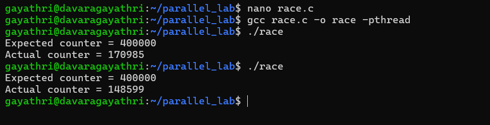

---

### 6.1.5 Mutex Synchronization

**Source:** `pthread/mutex.c`

A mutex is used to protect the shared variable from concurrent access.

Expected:

```text
400000
```

Actual:

```text
400000
```

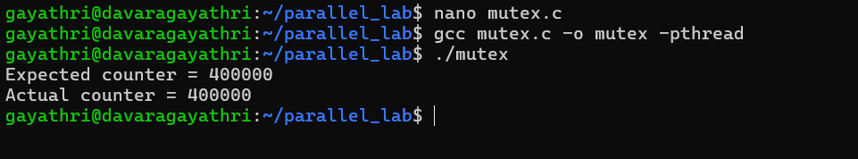

---

## 6.2 OpenMP Experiments

### 6.2.1 Basic Parallel Region

**Source:** `openmp/omp1.c`

Demonstrates an OpenMP parallel region using multiple threads.

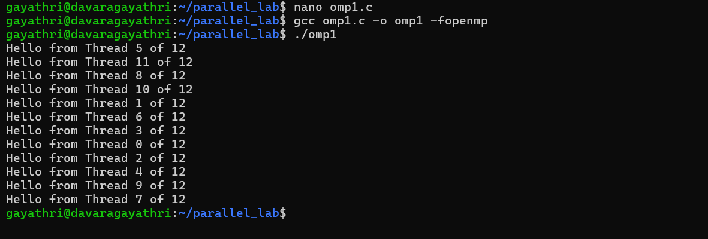

---

### 6.2.2 Reduction

**Source:** `openmp/omp_sum.c`

Uses OpenMP reduction to safely calculate the total.

Observed total:

```text
360
```

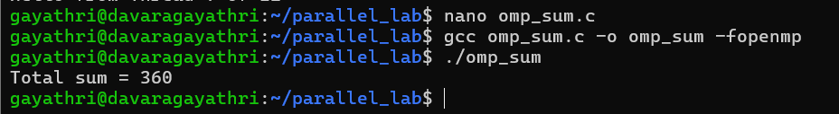

---

### 6.2.3 Race Condition

**Source:** `openmp/omp_race.c`

Demonstrates incorrect results caused by unsynchronized access to shared data.

Expected result:

```text
400000
```

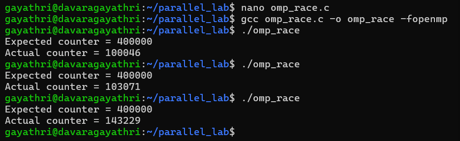

---

### 6.2.4 Critical Section

**Source:** `openmp/omp_critical.c`

Uses the OpenMP `critical` construct to protect the shared variable.

Expected:

```text
400000
```

Actual:

```text
400000
```

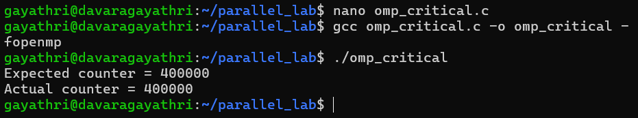

---

### 6.2.5 Barrier

**Source:** `openmp/omp_barrier.c`

Demonstrates synchronization between threads using an OpenMP barrier.

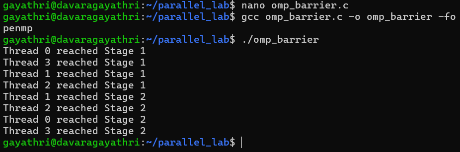

---

# 7. Performance Analysis

The performance experiment compares:

- Sequential execution
- Pthreads
- OpenMP

The tested thread counts are:

```text
1, 2, 4, 6, 8, 16
```

The performance workload uses a large computational loop to measure the execution time of the different approaches.

---

## 7.1 Sequential Baseline

Average sequential execution time:

```text
1.836582 seconds
```

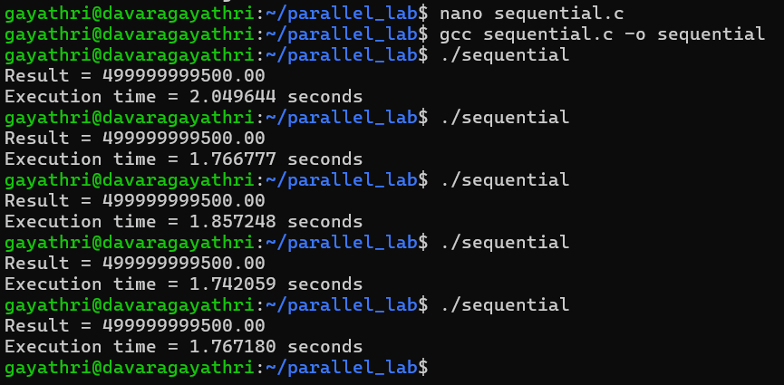

---

## 7.2 Execution Time

| Threads | Pthreads (s) | OpenMP (s) |
|---:|---:|---:|
| 1 | 1.799277 | 1.994585 |
| 2 | 1.027289 | 1.022189 |
| 4 | 0.623896 | 0.617940 |
| 6 | 0.555073 | 0.571046 |
| 8 | 0.494521 | 0.501827 |
| 16 | 0.433297 | 0.415766 |

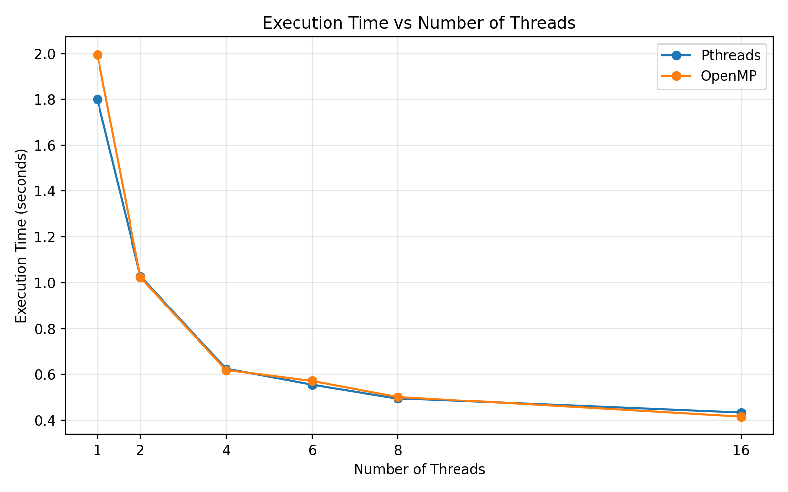

---

## 7.3 Speedup

Speedup is calculated using:

```text
Speedup = Sequential Time / Parallel Time
```

| Threads | Pthreads | OpenMP |
|---:|---:|---:|
| 1 | 1.021× | 0.921× |
| 2 | 1.788× | 1.797× |
| 4 | 2.944× | 2.972× |
| 6 | 3.309× | 3.216× |
| 8 | 3.714× | 3.660× |
| 16 | 4.239× | 4.417× |

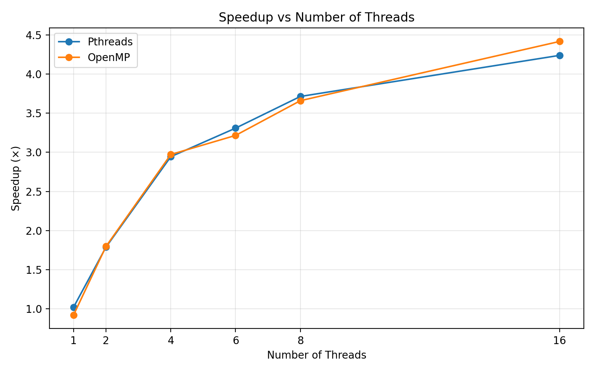

---

## 7.4 Efficiency

Efficiency is calculated using:

```text
Efficiency = (Speedup / Number of Threads) × 100
```

| Threads | Pthreads | OpenMP |
|---:|---:|---:|
| 1 | 102.07% | 92.08% |
| 2 | 89.39% | 89.84% |
| 4 | 73.59% | 74.30% |
| 6 | 55.15% | 53.60% |
| 8 | 46.42% | 45.75% |
| 16 | 26.49% | 27.61% |

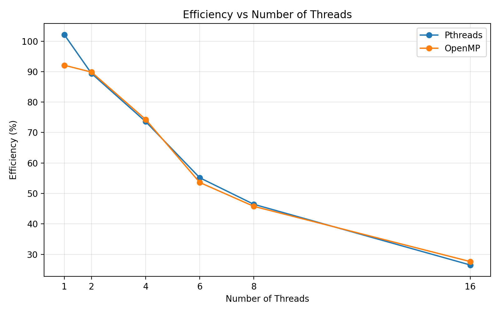

---

# 8. Graphs / Visualizations

The performance results are visualized using three graphs:

### Execution Time Comparison

Compares the measured execution time of Pthreads and OpenMP for different thread counts.


### Speedup Comparison

Shows the speedup obtained by Pthreads and OpenMP relative to the sequential baseline.


### Efficiency Comparison

Shows how efficiently the available threads are utilized as the thread count increases.


---

# 9. Observations / Interpretation

1. Increasing the number of threads generally reduced execution time for the tested workload.
2. Both Pthreads and OpenMP achieved measurable speedup compared with the sequential implementation.
3. Speedup did not increase linearly with the number of threads.
4. Thread management and synchronization introduce parallelization overhead.
5. Race conditions produced incorrect results when shared data was accessed without synchronization.
6. Mutex synchronization produced the expected Pthreads result.
7. The OpenMP `critical` construct produced the expected result.
8. OpenMP reduction provides a convenient method for combining partial results.
9. Pthreads and OpenMP showed similar performance for several thread counts.
10. At 16 threads, OpenMP had the lower measured execution time in this experiment.

---

# 10. Experimental Limitations

- Performance results depend on the hardware, operating system, compiler, workload, and system conditions during execution.
- Thread scheduling can affect measured execution time.
- Race-condition output may vary between executions.
- Speedup is not expected to scale linearly because of thread management, synchronization, and other parallelization overheads.
- The reported measurements represent the tested experimental environment and workload.

---

# 11. Technologies Used

| Category | Technology |
|---|---|
| Operating System | Ubuntu 24.04.1 LTS on WSL |
| Language | C |
| Compiler | GCC 13.3.0 |
| Multithreading API | POSIX Threads (Pthreads) |
| Parallel Programming API | OpenMP |
| Editor | Nano |
| Visualization | Python / Matplotlib |

---

# 12. Learning Outcomes

Through this experiment, the following concepts were studied and implemented:

- Creating and managing threads using Pthreads
- Executing multiple threads concurrently
- Dividing workloads among threads
- Understanding race conditions
- Applying mutex synchronization
- Creating OpenMP parallel regions
- Using OpenMP reduction
- Using OpenMP critical sections
- Synchronizing threads using barriers
- Measuring execution time
- Calculating speedup
- Calculating parallel efficiency
- Comparing different multithreading approaches

---

# 13. Conclusion

The experiment demonstrated fundamental concepts of multithreaded programming using Pthreads and OpenMP.

The implementations covered thread creation, multiple threads, work distribution, race conditions, mutex synchronization, OpenMP parallel regions, reduction, critical sections, and barriers.

Performance testing showed that parallel execution can reduce execution time for the tested workload. However, synchronization, thread management, and other parallelization overheads prevent speedup from increasing linearly with the number of threads.

The experiment also provided a practical comparison between explicit thread management using Pthreads and directive-based parallel programming using OpenMP.

---

# 14. Execution Screenshots

## Pthreads

### Thread Creation


### Multiple Pthreads


### Work Distribution


### Race Condition


### Mutex Synchronization


---

## OpenMP

### Basic Parallel Region


### Reduction


### Race Condition


### Critical Section


### Barrier


---

## Performance

### Sequential Baseline


### Pthreads Performance
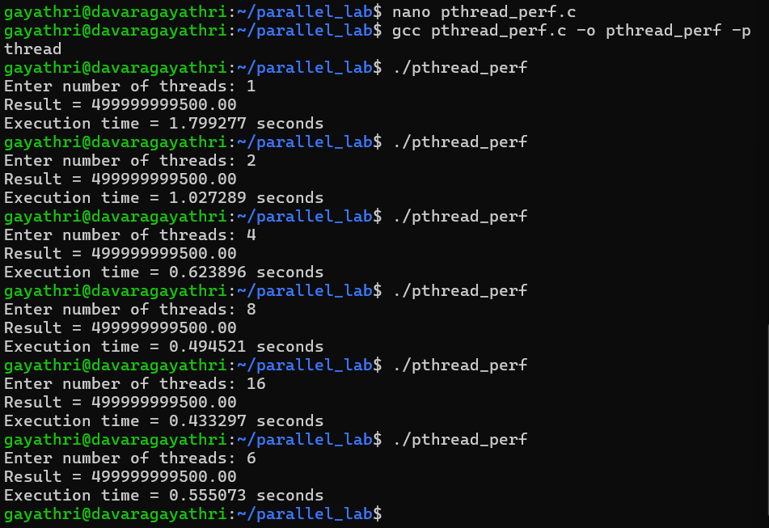

### OpenMP Performance
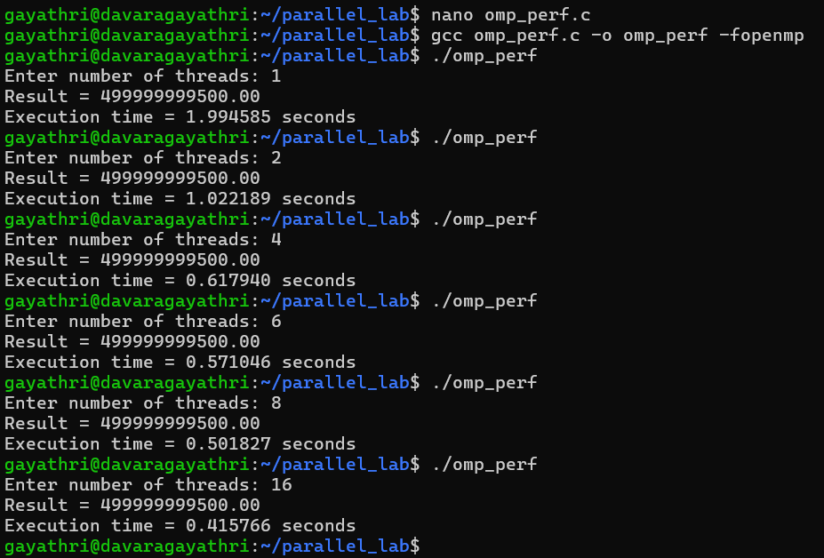